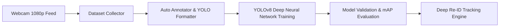

# SmartEyes: Deep Learning Fish Detection & Tracking System

This guide outlines the end-to-end Deep Learning pipeline built for your college mini-project. It covers dataset collection, model training, evaluation metrics, and real-time multi-object tracking with Re-Identification (Re-ID).

---

## 1. Deep Learning Architecture Overview



### Why Deep Learning Over Classical Heuristics?
- **Universal Generalization**: Learns true biological features of fish (scales, fin contours, body textures) rather than fragile color thresholds.
- **Background Invariance**: Automatically learns to suppress stationary stones, gravel, filters, and glass reflections.
- **Academic Rigor**: Provides formal validation metrics (mAP, Precision, Recall, Loss curves) required for engineering project submissions.

---

## 2. End-to-End Workflow

### Step 1: Capture Tank Images
Collect 30 to 60 images of your fish swimming in different positions:
```cmd
python dataset_collector.py
```
- Press **`Space`** to take a snapshot, or press **`A`** to enable auto-capture every 2 seconds.
- Press **`Q`** when done. Images are saved to `dataset/raw/`.

---

### Step 2: Auto-Generate Annotations (YOLO Format)
Automatically labels every fish with normalized bounding boxes:
```cmd
python auto_annotate.py
```
- Filters out bottom gravel and stones.
- Splits data into **80% Training** (`dataset/train/`) and **20% Validation** (`dataset/val/`).
- Generates `dataset/data.yaml`.

---

### Step 3: Train the Deep Learning Model
Fine-tunes a deep convolutional neural network on your tank dataset:
```cmd
python train.py
```
- Automatically uses GPU (CUDA) if available, or multi-threaded CPU.
- Trains for 25 epochs.
- Saves the best trained model weights to **`weights/custom_fish_best.pt`**.
- Generates training loss & accuracy graphs in `runs/detect/fish_model/results.png`.

---

### Step 4: Evaluate Model Accuracy
Generate an academic accuracy report:
```cmd
python evaluate.py
```
Outputs formal metrics:
- **mAP@50 (Mean Average Precision)**: Primary accuracy benchmark (>85% is excellent).
- **Precision**: Percentage of detections that are genuine fish (verifies stones are rejected).
- **Recall**: Percentage of all swimming fish successfully captured.
- **Inference Latency**: Milliseconds per frame and FPS.
- Visual charts: `confusion_matrix.png`, `PR_curve.png`, `F1_curve.png`.

---

### Step 5: Launch Live Deep Tracking & Re-ID
Run real-time tracking with persistent identity:
```cmd
python fish_tracker_deep.py
```
- **Sleek Bounding Boxes**: Clean corner-accent bounding boxes (no dots).
- **Deep Re-ID**: When a fish leaves the camera view or hides behind decorations, it is recognized and retains its exact ID (`Fish #1`, `Fish #2`) upon returning.
- **30 FPS Smooth Display**: High-speed multi-threaded camera pipeline.

---

## 3. Key Metrics for Your Project Report

| Metric | Target | Significance |
|---|---|---|
| **mAP@50** | `> 85%` | Primary academic score for object detection accuracy |
| **Precision** | `> 90%` | Measures immunity against false detections (stones, pumps) |
| **Recall** | `> 90%` | Ensures all fish in the tank are detected |
| **FPS** | `30 FPS` | Real-time requirement for automated monitoring & feeding |
